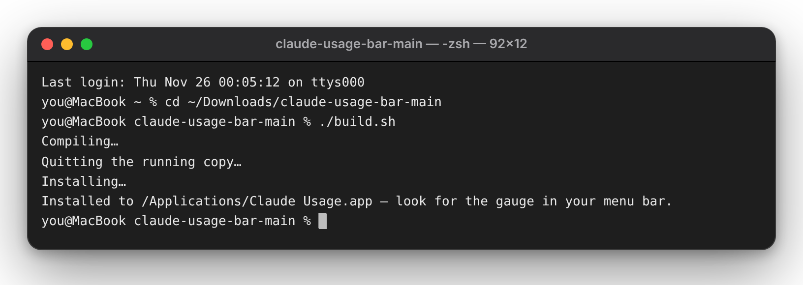
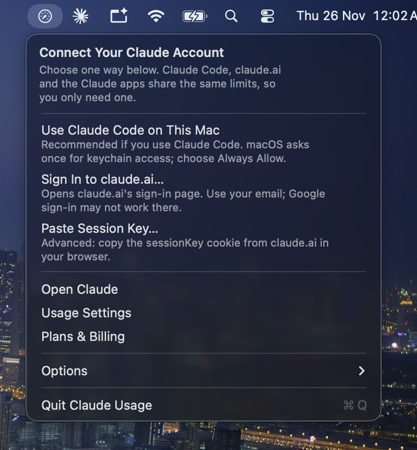
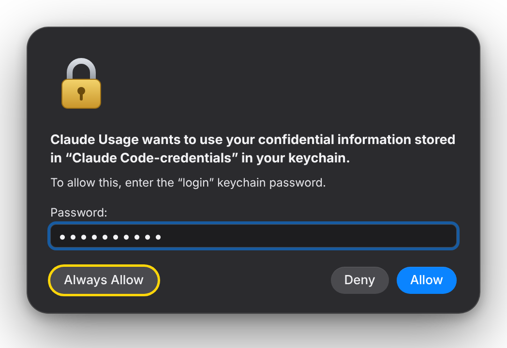
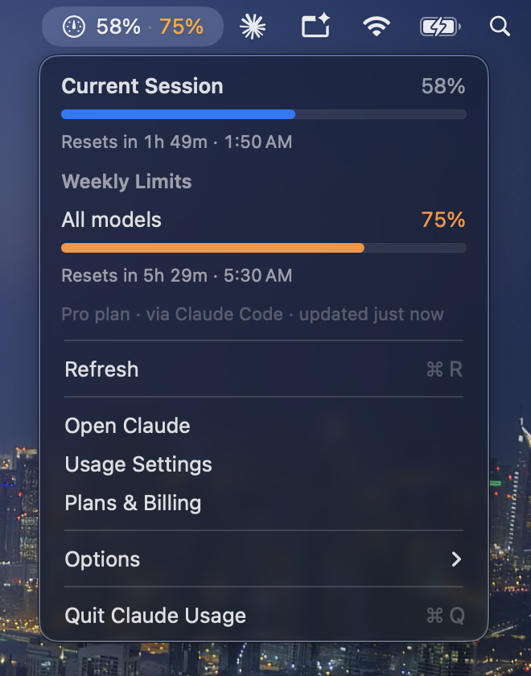
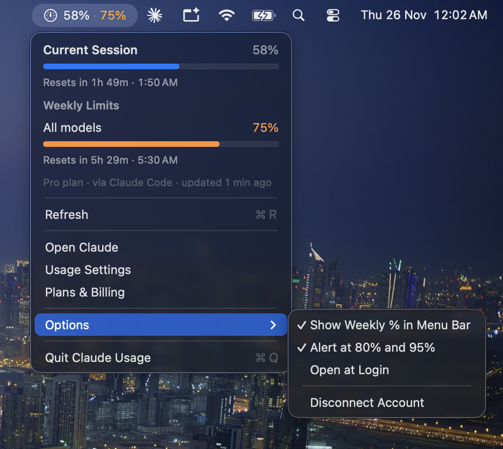

# Claude Usage Bar

**See how much of your Claude limit you've used — right in your Mac's menu bar.**

No more opening Claude → Settings → Usage every time. A small gauge sits next to your clock and fills up as you use your 5-hour session. Click it to see your session and weekly limits, and when they reset.

<p align="center"></p>

- 🟢 **Always visible** — your current session % (and, if you like, your weekly %) next to the clock
- 🟠 **Warns you early** — turns amber at 75% and red at 90%
- 🔔 **Notifications** at 80% and 95%, so you're never cut off mid-task
- 🍎 **Feels like part of macOS** — a standard menu like Battery or Wi-Fi, light and dark mode, no Dock icon, no extra windows
- 🔒 **Private** — runs entirely on your Mac and talks only to Anthropic

> **Not an official Anthropic app.** It reads the same numbers you see on claude.ai → Settings → Usage, using endpoints Anthropic doesn't document. If Anthropic changes them, the app may stop working until it's updated.

---

## Contents

1. [What you need](#1-what-you-need)
2. [Install](#2-install)
3. [Connect your Claude account](#3-connect-your-claude-account)
4. [Using it](#4-using-it)
5. [Options](#5-options)
6. [Updating](#6-updating)
7. [Uninstalling](#7-uninstalling)
8. [Troubleshooting](#8-troubleshooting)
9. [Privacy](#9-privacy)

---

## 1. What you need

- A Mac running **macOS 13 Ventura or later** (Apple menu  → About This Mac shows your version)
- A **paid Claude plan** (Pro, Max or Team) — these are the plans with session and weekly limits
- About **5 minutes**

You don't need to know how to code. You'll copy and paste two commands into an app called Terminal, and this guide shows you exactly what to type.

---

## 2. Install

### Step 1 — Download the app

1. At the top of this page, click the green **Code** button, then **Download ZIP**.
2. Open your **Downloads** folder and double-click **claude-usage-bar-main.zip** to unzip it.
   You'll now have a folder called **claude-usage-bar-main**.

### Step 2 — Open Terminal

Press **⌘ Command + Space**, type **Terminal**, and press **Return**. A window with a blinking cursor opens.

### Step 3 — Install Apple's developer tools (one time only)

The app is built on your own Mac, which needs Apple's free command-line tools. Copy this line, paste it into Terminal and press **Return**:

```bash
xcode-select --install
```

- If a window pops up, click **Install** and wait for it to finish (a few minutes).
- If Terminal says **"already installed"**, you're all set — go to the next step.

### Step 4 — Build and install

1. In Terminal, type `cd` followed by a **space** (don't press Return yet).
2. **Drag the `claude-usage-bar-main` folder** from Finder into the Terminal window. Its location appears after `cd`.
3. Press **Return**.
4. Now copy, paste and press **Return**:

   ```bash
   ./build.sh
   ```

After about 30 seconds you'll see **"Installed to /Applications/Claude Usage.app"**, and a gauge appears in your menu bar.

<p align="center"></p>

> **Comfortable with git?** You can do steps 1–4 in one go:
> ```bash
> git clone https://github.com/anuragk47/claude-usage-bar.git && cd claude-usage-bar && ./build.sh
> ```

---

## 3. Connect your Claude account

The first time it opens, the menu drops down by itself and asks you to connect. Pick **one** option — Claude Code, claude.ai and the Claude apps all share the same limits, so any of them shows the same numbers.

<p align="center"></p>

### Option A — Use Claude Code on This Mac *(recommended if you use Claude Code)*

1. Click **Use Claude Code on This Mac**.
2. macOS asks whether **Claude Usage** may use the "Claude Code-credentials" item in your keychain. Type your Mac password and click **Always Allow**.

   

That's it — your usage appears within a few seconds.

> Don't use Claude Code? Skip to Option B. Clicking "Always Allow" (not just "Allow") stops the question from coming back every minute.

### Option B — Sign In to claude.ai

1. Click **Sign In to claude.ai…**. A small window opens with claude.ai's normal sign-in page.
2. Sign in **with your email address** (Claude emails you a code or link).
3. The window closes by itself when you're in, and your usage appears.

> **"Continue with Google" may not work** in this window — Google blocks sign-ins from small embedded windows. Use your email instead, or Option C.

### Option C — Paste Session Key *(advanced)*

Use this if Option B doesn't work for you. You'll copy a value from claude.ai in your normal browser.

**In Chrome, Arc or Edge:**
1. Go to [claude.ai](https://claude.ai) and make sure you're signed in.
2. Press **⌥ Option + ⌘ Command + I** to open Developer Tools.
3. Click the **Application** tab → **Cookies** → **https://claude.ai**.
4. Find **sessionKey** in the list and double-click its **Value**, then press **⌘ Command + C** to copy it.

**In Safari:**
1. Safari menu → **Settings** → **Advanced** → tick **Show features for web developers**.
2. Go to [claude.ai](https://claude.ai), signed in, and press **⌥ Option + ⌘ Command + I**.
3. Click the **Storage** tab → **Cookies** → **claude.ai**, find **sessionKey** and copy its value.

Then click **Paste Session Key…** in the menu, paste with **⌘ Command + V**, and click **Connect**.

> Treat this key like a password — anyone who has it can use your Claude account. It's stored only on your Mac. It expires after a while; if the app says you're signed out, paste a fresh one.

---

## 4. Using it

### The menu bar

<p align="center"></p>

| You see | It means |
|---|---|
| The **gauge** | How full your current 5-hour session is. The needle moves right as you use Claude. |
| **58%** | Current session used |
| **58% · 75%** | Session used · weekly limit used (the weekly part can be turned off in [Options](#5-options)). In the picture above, the weekly limit is amber because it's past 75%. |
| Normal colour | Plenty left |
| 🟠 **Amber** | 75% or more used — the limit is getting close |
| 🔴 **Red** | 90% or more used — almost out |

Hover over the gauge for a quick summary.

### The menu

Click the gauge to open the menu.

<p align="center"></p>

- **Current Session** — how much of your 5-hour session you've used, and exactly when it resets ("Resets in 2h 11m · 4:30 PM")
- **Weekly Limits** — your weekly limit across all models, plus separate Opus or Sonnet limits if your plan has them
- The small line at the bottom shows which account is connected and when the numbers were last updated
- **Refresh** (⌘R) — check again right now. The app also refreshes by itself every minute.
- **Open Claude** — opens the Claude desktop app (or claude.ai if you don't have it)
- **Usage Settings** — opens claude.ai's usage page
- **Plans & Billing** — opens claude.ai's billing page, if you want to upgrade
- **Quit Claude Usage** (⌘Q)

---

## 5. Options

Click the gauge → **Options**. A tick means it's on.

<p align="center"></p>

| Option | What it does |
|---|---|
| **Show Weekly % in Menu Bar** | Shows your weekly limit next to the session one (`42% · 18%`). Turn it off to show only the session. *(On by default)* |
| **Alert at 80% and 95%** | Sends a Mac notification when your session or weekly limit reaches 80% and again at 95%. *(On by default)* |
| **Open at Login** | Starts the app automatically when you log in to your Mac. *(Off by default — turn this on so it's always there)* |
| **Disconnect Account** | Signs out, so you can connect a different account or pick another option. |

> **Notifications not showing?** The first time, macOS asks whether Claude Usage may send notifications — click **Allow**. You can change this later in System Settings → Notifications → Claude Usage.

---

## 6. Updating

1. Download the new ZIP (step 1 of [Install](#2-install)) and unzip it.
2. In Terminal, `cd` into the new folder (drag it in, as before) and run `./build.sh` again.

The script quits the old version and replaces it. Your settings and sign-in are kept.

> After an update macOS may ask about keychain access again (Option A) — click **Always Allow** once more.

---

## 7. Uninstalling

1. Click the gauge → **Quit Claude Usage**.
2. Open **Finder → Applications** and drag **Claude Usage** to the Trash.
3. *(Optional)* Remove its saved settings by pasting this into Terminal:
   ```bash
   defaults delete com.anurag.claudeusagebar
   ```
4. *(Optional)* If you turned on Open at Login, check **System Settings → General → Login Items** and remove any leftover entry.

---

## 8. Troubleshooting

<details>
<summary><b>I can't see the gauge in my menu bar</b></summary>

On MacBooks with a notch, macOS hides menu bar icons that don't fit. Quit a few other menu bar apps, or hold **⌘ Command** and drag icons to make room. Also check the app is running: open **Applications → Claude Usage**.
</details>

<details>
<summary><b>Terminal says "swiftc not found" or "xcrun: error"</b></summary>

Apple's developer tools aren't installed. Run `xcode-select --install`, click **Install**, wait for it to finish, then run `./build.sh` again.
</details>

<details>
<summary><b>Terminal says "permission denied: ./build.sh"</b></summary>

Run this once, then try again:

```bash
chmod +x build.sh
```
</details>

<details>
<summary><b>The menu says "Claude Code isn't signed in on this Mac"</b></summary>

Either sign in to Claude Code first (run `claude` in Terminal and follow the steps), or choose **Sign In to claude.ai…** or **Paste Session Key…** instead.
</details>

<details>
<summary><b>macOS keeps asking for keychain access</b></summary>

Click **Always Allow** rather than **Allow**. It asks once more after each update, because every build counts as a slightly different app to macOS.
</details>

<details>
<summary><b>An amber message says the usage request failed</b></summary>

Anthropic sometimes limits how often usage can be checked. The app keeps showing your last numbers and quietly retries; the message only appears if your numbers are more than 15 minutes out of date. If it doesn't clear, choose **Refresh**, or **Options → Disconnect Account** and connect again.
</details>

<details>
<summary><b>It says I'm signed out of claude.ai</b></summary>

claude.ai sessions expire after a while. Connect again with **Sign In to claude.ai…** or paste a fresh session key. Option A (Claude Code) doesn't have this problem as long as you use Claude Code now and then.
</details>

---

## 9. Privacy

- Everything runs **on your Mac**. There's no server, account or tracking.
- The app only talks to Anthropic: `api.anthropic.com` (Option A) or `claude.ai` (Options B and C), to read your usage — the same numbers as claude.ai → Settings → Usage.
- Your sign-in stays where it already lives: Claude Code's sign-in stays in your macOS keychain, and claude.ai sign-ins are kept by the app on this Mac only.

---

## For developers

A native AppKit + SwiftUI menu bar app (`NSStatusItem` with an `NSMenu`), no dependencies and no Xcode project — `build.sh` compiles `Sources/*.swift` with `swiftc`, ad-hoc signs the bundle and installs it.

| File | What's in it |
|---|---|
| `Sources/App.swift` | App entry, status item, menu, options |
| `Sources/UsageMenuView.swift` | The usage section at the top of the menu (SwiftUI) |
| `Sources/UsageStore.swift` | Fetching usage (Claude Code keychain token or claude.ai session), parsing, back-off, notifications, sign-in window |
| `build.sh` | Builds and installs to `/Applications` |

Issues and pull requests are welcome.

## License

[MIT](LICENSE) © Anurag Kumar
